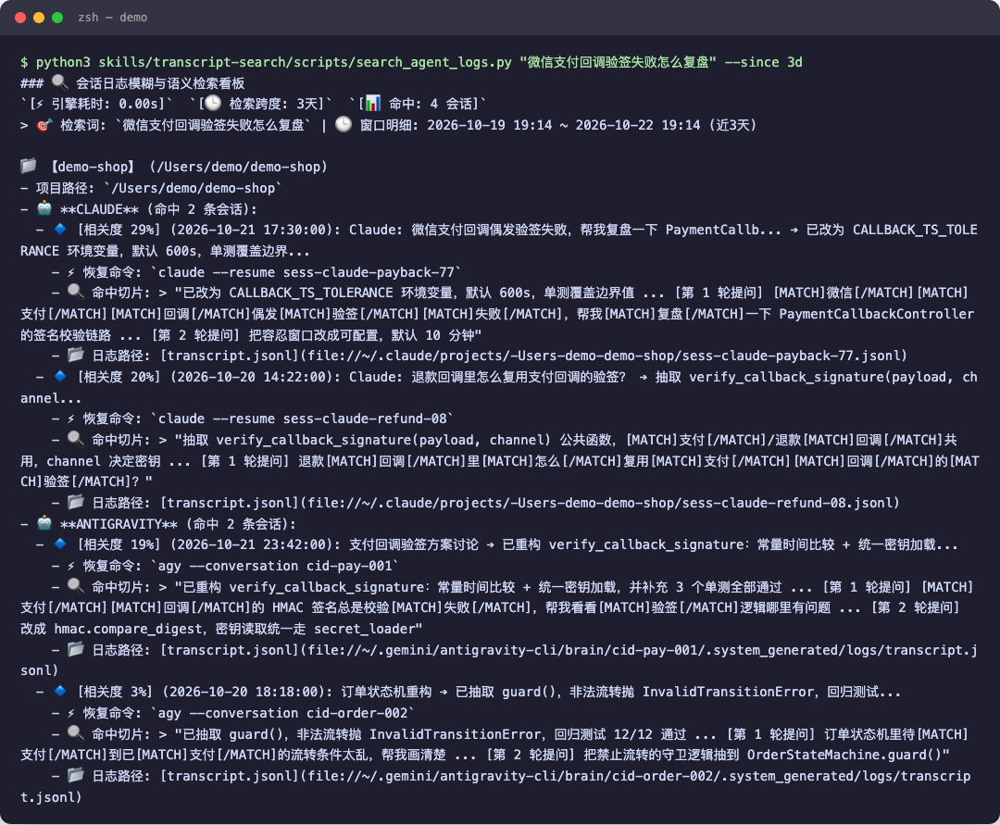
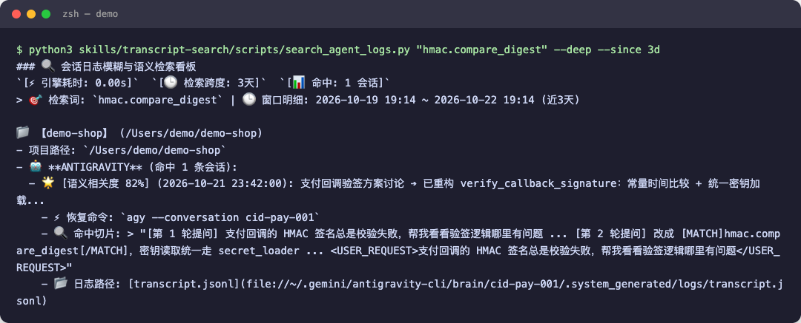
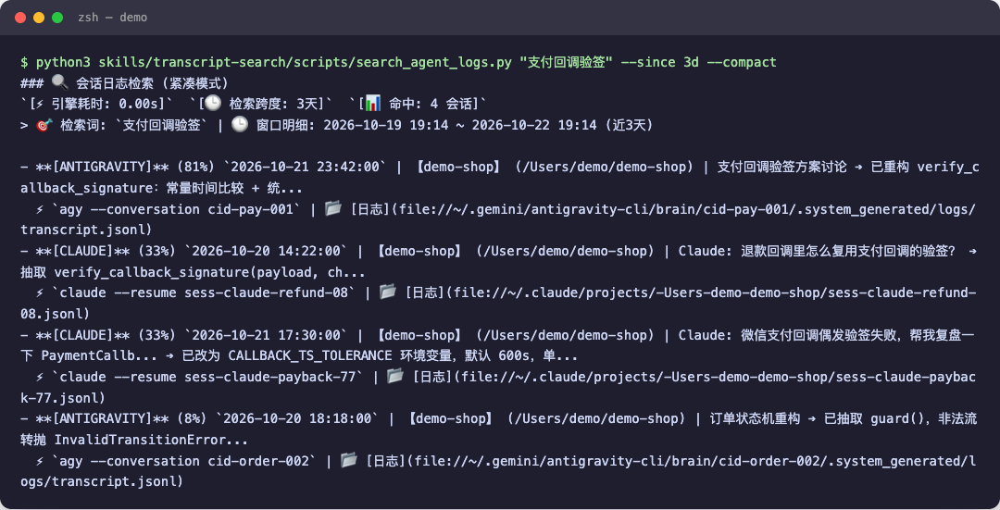

# DZ Skills

跨 20+ 款编程智能体（Claude Code, Antigravity, OMP, Pi, Codex, Cursor 等）的专业技能插件包与聚合技能库。

## 目录结构

```text
dz_skills/
├── .antigravity-plugin/
│   └── plugin.json
├── .claude-plugin/
│   └── plugin.json
├── plugin.json
├── skills/
│   ├── llm-authenticity-probe/   # LLM API 端点真伪探测与反代鉴别
│   └── transcript-search/        # 跨智能体会话日志模糊与语义检索
└── README.md
```

## 包含技能

| 技能名称 | 核心指令 | 说明 |
| :--- | :--- | :--- |
| [`llm-authenticity-probe`](skills/llm-authenticity-probe) | `/dz-llm-authenticity-probe` | 判断 Claude/GPT API 端点是否被套壳掺水（只证伪，不证实） |
| [`transcript-search`](skills/transcript-search) | `/dz-transcript-search` | 基于内存 SQLite FTS5 与本地混合打分的跨智能体会话日志高速检索 |

## 效果演示（模拟数据）

以下截图基于完全模拟的演示日志（虚构项目 `demo-shop`、编造会话）真实运行生成，不含任何真实会话内容。

**自然语言检索看板**（主要用法，直接用一句话描述想找的会话）：



**深度穿透模式**（`--deep`，直接命中底层工具调用与命令细节）：



**紧凑模式**（`--compact`，单行概要，适合 Agent 管道调用）：



## 命名空间规范

技能名统一以 `dz-` 为前缀（写在 `SKILL.md` 的 `name:` 字段），在 Claude Code、Codex、OMP、Pi、Antigravity 等编码智能体中一致可用：

```bash
# 调用示例（推荐直接用自然语言描述想找的会话）
/dz-transcript-search "前几天跟 Claude 讨论支付回调签名在哪"
/dz-transcript-search "支付回调状态机" --since 7d
/dz-llm-authenticity-probe --current
```

## 单元测试

两个技能均配备纯离线、零外部 API 依赖的高速自动化测试集：

```bash
# 测试 llm-authenticity-probe (48 tests)
pytest skills/llm-authenticity-probe/tests/ -q

# 测试 transcript-search (23 tests)
pytest skills/transcript-search/tests/ -q
```

## 许可证

- 仓库根规范与 transcript-search 采用 [MIT License](LICENSE)
- llm-authenticity-probe 采用 [Apache-2.0 License](skills/llm-authenticity-probe/LICENSE)
